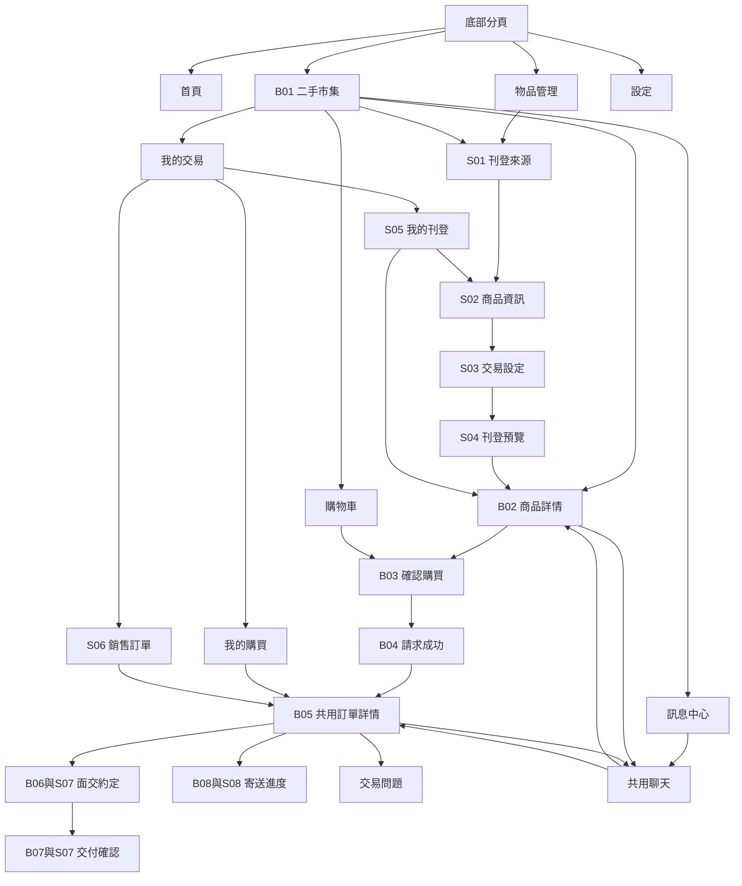
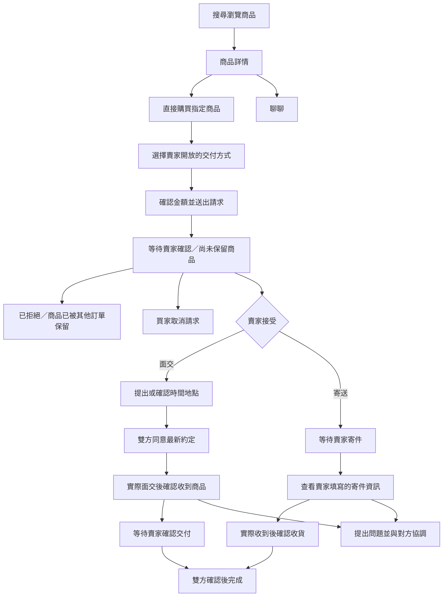
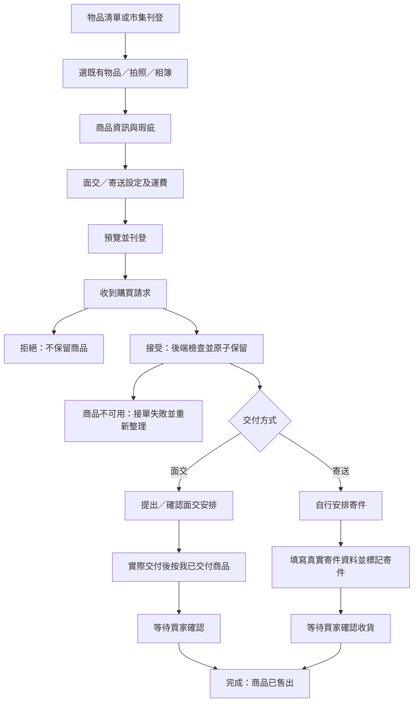

# 拾序二手市集：雙交付模式設計與實作規格

日期：2026-10-11。狀態：**設計待確認，尚未實作**。

本文件對應本次附件的八項交付成果。依附件「第一輪先不要修改正式程式碼或資料庫」，本輪只建立設計文件。以下新增欄位、RPC、畫面及規則都是提案，不能當作現有功能或已執行的 Migration。Android 與 PWA 後續必須一起實作。

## 1. 現況與程式證據

| 項目 | 判定 | 實際證據及限制 |
|---|---|---|
| 市集直接瀏覽、雙欄列表 | 已實作 | `src/screens/MarketScreen.tsx`、`web/main.tsx` 的 BuyerBrowse／Market；已有搜尋、分類、價格篩選、排序與分頁。不是從零重做 |
| 同帳號買賣、我的交易 | 已實作 | `MarketplaceWorkspaceScreen.tsx`，購買／刊登／銷售分頁；沒有必要新增身分切換 |
| 統一訊息入口 | 部分實作 | Workspace inbox、ChatScreen 可買賣對話；聊天缺少正式訂單卡片及返回訂單入口 |
| 商品詳情 | 部分實作 | `ProductDetailScreen.tsx` 有照片、價格、描述、分享、聊天、購物車；資料只有單張照片，沒有結構化狀況及交付方式 |
| 直接購買 | 部分實作 | 現在先加入購物車再到 Checkout，可能連原有購物車一起結帳；新版必須隔離直接購買的指定商品 |
| 從物品清單刊登 | 已實作 | `AddProductScreen.tsx`、`ItemManagementScreen.tsx`，可帶入名稱、分類、照片再編輯。保留在 P0，不因需求列於 P1 而移除 |
| 分步刊登及預覽 | 已實作／待擴充 | 已有來源、表單、預覽、成功；缺交付設定、狀況、瑕疵欄位 |
| 購物車 | 已實作 | `CartContext.tsx`、`cart_items`，user/listing 唯一、單件商品；加入購物車不保留庫存 |
| 訂單建立 | 已實作但語意不同 | `supabase/setup-all.sql` 的 `create_orders_from_cart`：依賣家分組、鎖定商品、建立 pending 訂單，**當下就將商品改 sold**，沒有接單階段 |
| 出貨／收貨／取消 | 部分實作 | `supabase/marketplace-workflow.sql` 的 `transition_market_order`：pending 賣家出貨、shipped 買家完成、pending 雙方可取消。不能等同本次完整流程 |
| 面交安排、雙方交付確認 | 尚未實作 | 現有 orders 沒有交付方式、面交約定與雙方確認欄位；文字提到面交不代表已有流程 |
| 真實物流與收款驗證 | 尚未實作 | 現有 COD／magic_coin 欄位不代表金流整合；無物流 API、物流事件或收款憑證核對 |
| RLS 與交易權限 | 已實作，需擴充 | orders/order_items 僅參與者讀取，寫入透過 RPC；刊登、購物車、聊天有身分及商品可用性限制。新增資料也必須沿用這個邊界 |
| 對外暱稱、評價、未讀數 | 尚未完整實作 | profiles 為本人讀取，不能直接開放整張個資表；目前不能產生真實評價或未讀數 |
| 真實使用與裝置現場結果 | 本輪無法確認 | 本輪是程式及資料結構分析，沒有新增正式交易、實際寄件、付款或操作兩支手機進行交易 |

現有市場資料主要由 `src/services/supabaseData.ts` 直接呼叫 Supabase。FastAPI 的 `src/backend/main.py` 主要提供 AI API；本需求不必為交易另造一套 FastAPI 狀態。優先擴充受保護的 Postgres RPC。

現有表：`listings`、`cart_items`、`orders`、`order_items`、`conversations`、`messages`。現行 listing 狀態為 active/sold/archived；order 狀態為 pending/paid/shipped/completed/cancelled。orders 的收件人、電話、地址目前為必填，不能直接拿來建立不需要地址的面交訂單。

UX 參考：[二手吐司官網](https://toas2t.com/) 的商品瀏覽、聊天與面交定位，以及 [旋轉拍賣官方說明中心](https://support.carousell.com/hc/zh-tw) 的買賣操作分類。下述雙模式狀態與版面是拾序的設計提案，不代表這兩個平台使用相同規則。

## 2. 需要確認的產品決策

「賣家接單」及「面交雙方確認」已是本次明確需求，以下以此為設計前提。其餘先採推薦方案供審查，未獲確認前不實作。

| 決策 | 現況 | 選項與推薦 | 影響 |
|---|---|---|---|
| 保留商品時機 | 建立訂單立即 sold | **推薦賣家接受才 reserved**；另可提出請求即保留 | 接受才保留允許多人請求，但只准一筆接單成功；成功頁須明示尚未保留 |
| 付款方式 | COD 欄位，無收款驗證 | **P0 面交自行付款、寄送由賣家自行安排貨到付款**；另可允許自行匯款 | 平台不代收、不宣稱付款成功；匯款會增加付款協調及詐騙處理範圍。賣家不支援貨到付款就不能開放此寄送方案 |
| 運費 | 同賣家小計大於 500 免運，否則 60 | **推薦賣家每件設定固定運費，同賣家同交付方式合單取最高一件運費**；亦可逐件累加、維持舊門檻 | 推薦規則是新規則，需確認；結帳前列明算法及總額。既有訂單保留原金額，不重算 |
| 接單後取消 | pending 任一方可直接取消 | **推薦交付前雙方同意取消**；另可允許任一方取消 | 同意前保留商品，取消提議期間暫停出貨／交付；已出貨或任一方已確認交付改走交易問題，不直接上架 |
| 多商品結帳 | 按賣家合單 | **保留，改按賣家＋交付方式分組**；另可一件一單 | 一組多件須全部可接受才接單，不部分接單；混合面交寄送會拆單，送出前顯示幾筆請求及各筆運費 |
| 無人回覆／自動完成 | 沒有新流程排程 | **P0 不自動接受、不自動完成、不自動逾時取消**；P1 再設到期排程 | 避免虛假倒數與無後端的自動處理；可顯示請求時間、手動取消及聯絡對方 |
| 面交／寄件資料保存 | 目前無相應資料 | **提案只向交易雙方提供，先不公開、不寫入一般聊天訊息**；保存期限另確認 | 正式上線前需決定期限、刪除／匿名化方式及訂單歷史需求；本文件不假設已有自動清除機制 |
| 交易問題 | 沒有正式爭議模組 | **P0 記錄問題、雙方協調及共同關閉**；平台仲裁／退款列 P2 | 不承諾客服介入或退款；有未關閉問題時不得自動完成，也不得釋出庫存 |
| 商品照片 | 一張 image_path | **P0 保留單張，P1 多圖輪播**；亦可提前多圖 | 單張時不畫輪播圓點；多圖涉及資料關聯、排序、上傳及清理，不能只補空 UI |

## 3. 完整資訊架構



不新增買家／賣家登入身分。伺服器依當筆訂單的 buyer_id/seller_id 決定操作權限。同一人可以在不同訂單分別是買家或賣家。

## 4. 買家完整流程



任一交付確認順序均可，不強制買家先按。流程圖呈現常見順序；實際狀態由下方表格定義。

## 5. 賣家完整流程



## 6. 共用視覺與互動規格

沿用 `platformAppearance.ts` 與 PWA 主題變數：深色背景 #151B18、卡片 #202823、主文字 #F0F3F1、次文字 #AFBAB3、主按鈕 #9AC8AE 配深色文字 #17291F。保留現有淺色設定，兩種主題都檢查對比；狀態除了顏色必須附文字。

- 手機單欄內容、商品列表雙欄；頁側距 16、卡片內距 16、區塊間距 20、圓角沿用既有元件。價格優先於次要資訊，正文至少 16，輔助資訊約 14，允許字體放大與換行。
- 主操作觸控至少 48×48；圖示附 accessibilityLabel，選項附選取狀態。不得固定文字高度導致裁切。錯誤訊息靠近欄位並可被讀屏讀取。
- 市集根頁保留底部四分頁；詳情／表單可保留現行導航習慣，固定操作列必須位於 Safe Area 上方，正文預留同等底部空間，不疊在主分頁上。
- 表單使用 KeyboardAvoidingView／可滾動容器；PWA 使用 visual viewport 與 safe-area inset，鍵盤開啟時仍能看見焦點欄位。送出前失焦並定位第一個錯誤。
- Mutation 處理中只鎖當次操作；成功以伺服器回應更新，失敗保留輸入。超時不等於失敗：以相同冪等鍵查回原結果，不能盲目新建一次。
- 返回保留搜尋、分類、位置與尚未提交表單；離開未儲存表單提示「保留編輯／離開」。P0 只保留當次工作階段，不宣稱已有跨裝置草稿。
- 單件商品數量固定 1，無加減數量器。沒有評價、收藏、未讀、物流串接的資料就不顯示對應假控制項。

共用讀取狀態：初次讀取骨架；更新時保留舊資料並標示更新；空狀態提供合理入口；失敗提供重試。權限／商品不存在提供返回；不可把 403 顯示為空清單。登入失效保存安全的返回路徑並引導登入，不能送出匿名交易。

## 7. 逐頁 Wireframe 規格

以下是元件由上到下的確切順序。共用畫面只維護一套規則，依角色產生文案與操作；不另外做兩套相互不同步的訂單頁。

### W01／B01 市集首頁

版面：①「二手市集」＋訊息、購物車圖示；②「我的交易」與「＋刊登」入口列；③搜尋框；④橫向分類；⑤結果數、篩選、排序；⑥雙欄商品；⑦載入更多；⑧四分頁。

商品卡順序：方形圖片 → NT$ 價格 → 最多兩行名稱 → 狀況 → 地區／面交寄送標籤。狀況未知顯示「狀況未填」，不從 AI 推測。主操作點商品到 W02；刊登到 W06；次操作篩選抽屜提供價格、方式、地區，套用後才更新結果。P0 沿用已有分類，不為視覺改名而破壞舊資料。

Loading：6 個骨架；翻頁底部 spinner。Empty：無符合商品＋清除篩選；全站空則「目前尚無商品」＋刊登。Error：保留既有列表，區塊重試。售出／保留即移出可購買列表；使用者停留舊卡時進詳情仍重新驗證。

### W02／B02 商品詳情

版面：①返回、分享；②商品圖（P0 單張；未上多圖前無輪播點）；③大價格、名稱、狀況；④描述、瑕疵；⑤交付方式卡、運費與地區；⑥賣家識別；⑦底部「聊聊｜直接購買」，加入購物車為次要按鈕。

主操作直接購買到 W03，帶 listingId，**不先加入或讀取整份購物車**。聊聊開現有商品對話。分享需包含可重新載入的商品 ID 路徑；完成持久路由前不可宣稱分享連結可開商品。賣家暱稱尚無安全公開 API 時延用最小識別，不讀私人 profile。

Loading：圖文骨架。Empty：不存在／無權查看＋返回市集。Error：重試，停用購買。自己商品：管理刊登、查看訂單；保留中：顯示「交易保留中」停用買／加購；sold：已售出；archived：已下架。參與者可查看歷史商品，不能因此再購買。

### W03／B03 確認購買，含購物車共用結帳

```text
‹ 確認購買
[商品縮圖] 名稱                 NT$ 300  ×1
交付方式  ◉ 面交  ○ 寄送
[面交地區說明／寄送收件表單]
商品小計                       NT$ 300
運費                           NT$   0
合計                           NT$ 300
送出後等待賣家接受，商品尚未保留。
本平台未提供代收付款及物流保障。
[送出購買請求]
```

寄送才收姓名、電話、地址；面交不強迫填寄送地址。僅開放一種時顯示固定方式，不畫可切換選項。運費須為可計算實際數值，不能用「洽談」卻讓訂單寫入假 0 元。金額用後端價格及設定計算，送出前若變價要求重新確認。

購物車先勾商品、逐件選允許方式，再按「賣家＋方式」分組。每組顯示金額及商品，底部「送出 N 筆購買請求」。任一商品無效則整次送出失敗、列出無效項目，讓買家修改選取後重送；不默默部分成功。

Loading：重新核對商品價格及方式，未完成不能送出。Empty：沒有選取商品→返回購物車；直接購買無商品→返回市集。Error：欄位下顯示、頂部摘要；網路超時先查原請求。送出只鎖一次、保留冪等鍵。方法變更後清楚更新金額，不傳給前端自由指定付款成功狀態。

### W04／B04 請求送出成功

版面：①成功符號；②「已送出購買請求」；③「等待賣家確認，確認後即可進行後續交易。」；④商品摘要／多單清單；⑤「商品尚未保留，仍需賣家確認」；⑥主「查看訂單」、次「聯絡賣家」「返回市集」。

多單時逐筆查看，聊天需選對應商品而非隨機開一個賣家對話。Loading：用已回傳訂單 ID 查狀態。Empty：缺 ID 不顯示成功，回我的購買查詢。Error：提示「請求可能已建立，請先查看我的購買」，不得再產生新請求。已被接受／拒絕時顯示最新狀態，不固定停留成功文案。

### W05／B05 共用訂單詳情，亦由 S06 進入

```text
‹ 訂單詳情                  ⋯
[等待賣家確認]
下一步：由賣家接受或拒絕
● 已提出 ─ ○ 已接受 ─ ○ 交付中 ─ ○ 完成
[商品縮圖、快照名稱、價格、數量]
[面交／寄送方式與當時金額]
[交易對象] [聊聊]
[面交安排／寄件資訊：依狀態顯示]
[時間與操作紀錄]
[依角色及狀態的主操作]
```

買家 requested：主聯絡賣家、次取消請求；賣家 requested：主接受、次拒絕，拒絕需確認及理由。accepted meetup：安排面交；accepted shipping：買家等待／賣家填寄件資訊。單方交付：本人已確認、主聯絡對方；不能再按自己的確認。completed：查看紀錄、聯絡；無再次出貨按鈕。取消／拒絕顯示原因，進度線不塗滿成完成。

進度採一個後端狀態投影。合單列全部商品，接單按鈕明示接受整筆。取消提議／交易問題置頂提示，優先於一般主操作。Loading：骨架；更新保留快照。Empty：不存在／無權讀取→我的交易。Error：重試；過期操作先重新取得狀態，提示「訂單已更新」。禁止只在前端改 badge 當成功。

### W06／S01 開始刊登

版面：①返回、標題；②「從我的物品選擇」卡；③「拍照新增」「從相簿新增」兩個獨立入口；④來源物品清單含搜尋、縮圖、名稱、分類。

主操作選來源後到 W07。物品資料帶入皆可改，狀況與價格不得從 AI 當事實。Loading：只載入自己的物品骨架。Empty：尚無物品→拍照／相簿。Error：物品載入重試，仍可拍照。相機拒權顯示設定指引；相簿取消保持本頁。平台檔案選取差異保留，兩端均能完成來源選擇。已選物品不自動改其保留／待售意圖。

### W07／S02 商品資訊

版面：①「1/3 商品資訊」；②圖片＋重新拍攝／更換相簿；③名稱；④分類；⑤使用狀況；⑥描述；⑦瑕疵說明；⑧售價；⑨主「下一步：交易方式」。

狀況提案：全新／近全新／正常使用／有瑕疵但可使用；「未確認」允許舊資料展示但新刊登必須選。不能強迫損壞物品當成可用；不可用物品可顯示既有回收入口，勿自動刊登。瑕疵選項需要填說明，其他可填「無已知瑕疵」。圖片、名稱、分類、狀況、有效價格必填；價格允許 0 與否待沿用既有非負規則，0 顯示 NT$ 0，不當缺值。

主下一步驗證後到 W08；次返回來源保留當次輸入。Loading：私有來源圖轉上傳時顯示進度；不以不可公開存取的 inventory URL 直接當商品圖。Empty：無圖顯示補圖。Error：欄位保留、定位錯誤；上傳失敗可重試，不能因重試重複刊登。編輯 reserved/sold 商品不開啟自由修改交易條款。

### W08／S03 交易方式

版面：①「2/3 交易方式」；②允許面交開關；③開啟後地區、面交偏好；④允許寄送開關；⑤開啟後自行寄送方式、固定運費、寄送備註；⑥「平台未串接金流與物流」；⑦主「下一步：預覽」。

至少選一種。面交地區必填，不填私人完整住址；偏好非正式約定。寄送必填可實行的方式及非負運費，0 為免運，未填不等於 0。貨到付款適用限制清楚顯示；不提供不存在的超商取貨門市選擇器。主到 W09；次回 W07。Loading：編輯先載原設定。Empty：初始未選提示選方式。Error：欄位內顯示、不聲稱設定已保存。切關保留當次輸入但不提交未啟用資料。

### W09／S04 預覽及刊登結果

版面：①「3/3 預覽」；②與商品詳情相同圖片、價格、名稱、狀況、描述、瑕疵、方式及運費；③主「確認刊登」、次「返回修改」。

確定後建立一筆 listing，成功呈現「刊登成功」＋查看商品／我的刊登／返回市集。Loading：上傳／建立中鎖送出；預覽價格不作後端可信來源。Empty：缺任何必要值回對應步驟。Error：保留內容、同一冪等鍵查回，不重複新增；成功畫面必須有真實 listingId。修改現有 listing 成功文案為「已儲存修改」，不另造商品。

### W10／S05 我的刊登，共用我的交易外框

版面：①「我的交易」；②購買／刊登／銷售分頁；③上架中／保留中／已售出／已下架篩選；④商品橫卡；⑤＋刊登。

卡片順序：縮圖、名稱、價格、真實狀態、查看／編輯／更多。active 可編輯下架；archived 可上架；reserved 只查看關聯訂單與聯絡，不可改價格、方式或再上架；sold 查看紀錄。主新增到 W06；卡片到 W02；關聯訂單到 W05，若多筆先列出選擇。

Loading：分頁骨架，切換不得短暫顯示另一頁資料。Empty：各狀態分開文案＋刊登／清除篩選。Error：區塊重試，不清掉已載頁。下架時若存在尚未接受請求，後端一併拒絕並說明「商品已下架」；有保留訂單禁止下架。

### W11／S06 銷售訂單與我的購買列表

版面：①共用我的交易外框；②全部／待回覆／進行中／已完成／已結束篩選；③訂單卡：狀態、縮圖名稱、金額、交付方式、對象、時間、下一步；④分頁載入。

主點卡到 W05。賣家待回覆卡可提供「查看並回覆」，接受／拒絕在詳情確認，避免列表誤觸。買家卡不可看到賣家接單按鈕。待寄件、待約定、待對方確認均有具體文案，不能全部寫「處理中」。Loading／Empty／Error 同 W10，空銷售提示「尚無購買請求」，空購買提供逛市集。

### W12／B06＋S07 面交約定

版面：①商品與對象摘要；②「尚未約定／等待你確認／等待對方確認／雙方已確認」；③日期、時間、地點、備註；④提出者與更新時間；⑤主操作；⑥聊聊。

未約定：任一方填資料「提出面交安排」。已有提案：提出者顯示等待，對方「確認這個安排」／「提出修改」。修改建立新版本並清除舊同意；兩人看到完全相同的最新版本。已約定：顯示具體日時地點，主「前往交付確認」到 W13；次「修改約定」。任一交付確認後不准再改約定。

日期時間以使用者可理解的台灣時間顯示，資料使用 timestamptz；地點文字即可，無 GPS 依賴。新提案不能填已過日期，但交付確認不強制一定晚於預定時間，允許雙方提前實際交付。Loading：載目前版本；Empty：確實無安排顯示表單；Error：版本衝突提示「對方已修改安排，請重新確認」，不可默認接受新版本。

### W13／B07＋S07 面交交付確認

版面：①已約定摘要；②「賣家交付確認／買家收貨確認」兩列勾選與時間；③本人主按鈕；④聯絡對方；⑤提出交易問題。

賣家主「我已交付商品」；買家主「我已收到商品」。確認對話「請確認已實際交付／收到商品；此操作不代表平台驗證付款。」提交後顯示本人已確認、等待對方；兩邊均確認且無未關閉問題才完成。完成後兩列勾選，返回 W05。

Loading：取雙方確認資料；Empty：無已同意約定→回 W12，不開確認。Error：保留 server state 可重試，同一確認冪等。取消提議／問題未解決時顯示處理入口，不把進度塗成完成；不得取消後重新上架已有單方交付確認的商品。

### W14／B08＋S08 寄送進度

版面：①商品摘要與目前狀態；②待寄件 → 賣家標記寄件 → 買家確認收貨；③收件資料卡（參與者可見）；④寄件資料卡；⑤底部角色主操作、聊聊／提出問題。

賣家待寄件：表單物流商（有則填）、實際寄件日期（必填且不能未來）、追蹤碼（有則填）、備註；主「標記已寄件」，二次確認已實際交運。買家待寄件：等待提示，不顯示收貨按鈕。已標記寄件：明示「以下為賣家填寫，非物流商驗證」，買家主「確認收到商品」，確認框再次說明實際收到才按。賣家主查看寄件資料，不可替買家確認。

不生成假單號／條碼，不因輸入追蹤碼顯示「配送中」。MVP 已寄件資料只讀，輸入錯誤由問題紀錄及聊天補充；P1 可提供帶審計的修正。Loading：讀寄件紀錄；Empty：未寄件是正常狀態而非錯誤；Error：欄位保留、寄件請求超時查回。已完成移除收貨／出貨按鈕。

### W15／共用訊息中心與聊天

訊息中心順序：①標題；②對話列表：商品縮圖、對象識別、商品名稱、最後訊息、時間；③點擊進聊天。沒有已讀資料前不顯示假紅點／未讀數。Loading 骨架；Empty「尚無對話」＋逛市集；Error 重試。

聊天順序：①對象與返回；②可點商品摘要；③關聯訂單摘要（有多筆先選，最新有效單優先，歷史可看）；④訊息；⑤輸入列。訂單卡讀相同訂單投影，點「查看訂單」到 W05，不在聊天自行維護狀態。從訂單進來保留 orderId，返回原單；從商品進來尚無單不畫訂單卡。

Loading：訊息讀取與訂單摘要分開，局部失敗不阻止另一區閱讀。Empty：無訊息顯示「可先詢問商品狀況」。Error：發送失敗保留輸入及可重試標記；不得因 last_message_at 更新失敗誤報訊息未寫入而重複送訊息。P0 用原子訊息寫入更新排序時間；長對話分頁避免無限制載入。polling 僅前景運作，返回／恢復前景重新讀正式狀態。

### W16／共用取消與交易問題

取消以對話框呈現：requested 買家可直接取消；accepted 且未寄件、雙方皆未確認交付，可提出取消，對方同意才生效，拒絕則回原進度。顯示商品、原因、目前取消提議者及結果。已有交付事件不顯示普通取消。

交易問題頁順序：商品訂單 → 類型（未收到／物品不符／面交問題／其他）→ 說明 →「記錄問題並聯絡對方」。文案「平台目前未提供仲裁或退款服務」。雙方可閱讀紀錄、分別「已協調解決」；都確認才關閉問題。任何人再提出新問題需獨立紀錄，不能覆寫原文。問題開啟時不自動完成／釋出商品。

Loading：提交鎖按鈕；Empty：沒有問題顯示正常交易入口；Error：輸入保留、冪等重試。沒有後端紀錄成功前不能顯示「已受理」；不提供無實作的客服按鈕。

## 8. 狀態模型與轉換表

### 六個獨立維度

| 維度 | 提案值／來源 | 含義 |
|---|---|---|
| 商品狀態 | active、reserved、sold、archived | 可購買／接單保留／交易完成／自行下架 |
| 交易狀態 | requested、accepted、fulfilling、completed、rejected、cancelled | 同一真實來源，不能用商品 sold 推定訂單完成 |
| 交付方式 | meetup、shipping | 下單時快照，接單後不可自行改 |
| 面交進度 | 從約定版本、雙方同意、交付確認推導 | 未約定／待對方確認／已約定／待雙方交付確認／完成 |
| 寄送進度 | 從 shipment 與 buyer_received_at 推導 | 待寄件／已標記寄件、待買家確認／完成；中間兩個文案可同時描述同一階段 |
| 雙方確認 | seller_handed_over_at、buyer_received_at | 面交雙方必須有值；寄送 seller 事件是標記寄件，不能當實際送達 |

交易異常以開放中的 `order_issues` 投影為「有交易問題」，保留底層交付狀態，避免 lost state。取消提議亦是附加狀態，不任意將 accepted 改回 requested。完成必須無未關閉問題、無待確認取消提議。

### 共用轉換

| 現在 → 觸發者 → 操作 | 下一狀態 | 買家畫面／主操作 | 賣家畫面／主操作 | 後端必要條件 |
|---|---|---|---|---|
| 無 → 買家 → 送出請求 | requested；商品仍 active | 等待確認／聯絡 | 待回覆／接受或拒絕 | 本人、非自己的商品、全部 active、允許方式、金額重新核對、有效必填資料、冪等鍵 |
| requested → 賣家 → 接受 | accepted；全部商品 reserved | 已接受／安排面交或等待寄件 | 已接受／安排或寄件 | 鎖定全部商品並重新驗證；無其他有效 allocation；以當時報價和條款接受 |
| requested → 賣家 → 拒絕 | rejected；商品不因本單改動 | 已拒絕／返回市集 | 已拒絕／看紀錄 | 本單賣家、未接受、保存理由 |
| requested → 買家 → 取消 | cancelled | 已取消／返回市集 | 買家已取消／看紀錄 | 本單買家，沒有接受成功的競態 |
| requested → 系統 → 另一訂單接單／商品下架或變價改條款 | rejected | 商品不可用／看原因 | 請求已失效／看紀錄 | 僅失效未接單請求，不能取消別人的已保留訂單 |
| accepted → 任一方 → 提議取消 | 狀態不變，cancel_pending | 顯示提議／本人等待或回覆 | 同左 | 未寄件、雙方交付確認皆空、無未關閉問題 |
| cancel_pending → 對方 → 同意 | cancelled；符合條件才 active | 已取消／看紀錄 | 已取消／管理商品 | 再核對未交付，原子釋出 allocation；不復活舊請求 |
| cancel_pending → 對方 → 拒絕 | 回原交付可操作狀態 | 取消未同意／聯絡 | 同左 | 對方身分、版本吻合、記錄理由；不清除原交付資料 |
| accepted/fulfilling → 任一方 → 記錄問題 | 原狀態＋issue_open | 問題待協調／聯絡 | 同左 | 訂單參與者、有效類型、描述、冪等鍵；不釋出商品 |
| issue_open → 雙方各自 → 已協調解決 | 雙方同意後關閉 | 等另一方或恢復流程 | 同左 | 同一問題版本雙方確認；若交付條件已齊，才在同交易內完成 |

### 面交專用轉換

| 現在 → 觸發者 → 操作 | 下一狀態 | 買家顯示／主操作 | 賣家顯示／主操作 | 後端必要條件 |
|---|---|---|---|---|
| accepted、無約定 → 任一方 → 提安排 | accepted、待對方確認 | 提出者等待，對方確認 | 同左 | meetup 單、未取消提議、無交付確認、有效日時地點 |
| 待確認 → 對方 → 同意版本 N | accepted、已約定 | 已約定／交付確認 | 同左 | 版本 N 仍最新，兩方同意同一版本 |
| 待確認或已約定 → 任一方 → 修改 | accepted、版本 N+1 待確認 | 最新提案／確認或等待 | 同左 | 沒有交付確認；重置雙方同意並給提出者新版本同意 |
| 已約定 → 賣家 → 我已交付 | fulfilling，賣家確認 | 待你確認／我已收到 | 已確認／聯絡 | 賣家、最新約定雙方同意、無取消提議或問題，寫 server time |
| 已約定 → 買家 → 我已收到 | fulfilling，買家確認 | 已確認／聯絡 | 待你確認／我已交付 | 買家，同上；允許買家先確認 |
| fulfilling、單方確認 → 另一方 → 確認 | completed；商品 sold | 交易完成／紀錄 | 交易完成／紀錄 | 兩方確認齊、沒有問題或取消提議；在同一 transaction 完成 |

若只有一方確認，任何等待時間都不能自動宣稱完成；P0 沒有自動倒數。交付確認不表示平台驗證線下付款。

### 寄送專用轉換

| 現在 → 觸發者 → 操作 | 下一狀態 | 買家顯示／主操作 | 賣家顯示／主操作 | 後端必要條件 |
|---|---|---|---|---|
| accepted → 賣家 → 標記已寄件 | fulfilling、shipment 有值 | 賣家已標記寄件／確認收到 | 等待收貨／看寄件資料 | shipping 單、本單賣家、真實日期非未來、收件資料有效、無取消提議或問題 |
| fulfilling → 買家 → 確認收到 | completed；商品 sold | 已完成／紀錄 | 已完成／紀錄 | 本單買家、已標記寄件、無問題或取消提議；server time、原子完成 |
| fulfilling → 任一方 → 普通取消 | 禁止，保持原狀 | 改為提出問題 | 同左 | 不可釋出已寄出商品；不能使用未寄件取消 RPC 繞過 |

禁止：買家替賣家接單、賣家替買家收貨、未接單直接出貨、未約定面交直接交付確認、拒絕後再接受、已取消後復活、completed 再出貨、任何參與者改另一方 id。操作合法性只由後端決定。

## 9. 資料關聯與擴充提案（不執行）

優先 text＋CHECK，沒有必要為概念狀態直接新增 ENUM。欄位名稱為設計草案，Migration 須在開始實作後審核。

| 表 | 建議擴充 | 驗證及關聯 |
|---|---|---|
| listings | condition、defects、allow_meetup、allow_shipping、meetup_area、meetup_note、shipping_method_note、shipping_fee、version、client_request_id；status 加 reserved | 至少一種方式；寄送需有效費用和方式；新增冪等 unique(seller_id,client_request_id)。舊資料方式未明不可自動猜測 |
| orders | workflow_version、delivery_method、version、accepted_at、rejected_at、cancelled_at、completed_at、decision_reason、seller_handed_over_at、buyer_received_at、cancel_requested_by、cancel_requested_at、checkout_batch_id、group_key、payload_hash | 新單狀態用新 CHECK；unique(buyer_id,checkout_batch_id,group_key)；同鍵不同內容拒絕；面交不要求郵寄地址，寄送條件 CHECK 才要求姓名電話地址 |
| order_items | image_path_snapshot、category_snapshot、condition_snapshot、delivery_terms_snapshot、is_active_allocation | 沿用名稱與價格快照；費用條款也快照。allocation 僅 RPC 可寫，對 listing_id 建 WHERE is_active_allocation 的唯一索引 |
| order_meetups（新） | order_id PK/FK、version、proposed_by、starts_at、place、notes、buyer_agreed_version、seller_agreed_version、updated_at | 一單一個目前安排；server 驗證參與者與相同版本；歷史變更寫 events |
| order_shipments（新） | order_id PK/FK、carrier、dispatched_at、tracking_number、note、marked_by、marked_at | 一單一筆手動寄件；只有本單賣家透過 RPC 可建立，不能當作物流驗證事件 |
| order_events（新） | id、order_id、actor_id、event_type、occurred_at、有限必要 metadata | 伺服器附加寫入審計，客戶端不能改；不複製完整地址／電話到 event metadata |
| order_issues（新） | id、order_id、opened_by、type、details、opened_at、buyer_resolved_at、seller_resolved_at、resolved_at、client_request_id | 每筆問題保留原紀錄；一單可有歷史問題；所有開放問題都解決才可完成 |
| conversations/messages | 優先保留現有關聯；新增發送冪等鍵及原子更新最近訊息時間 | 不把 order_id 塞進一個只能單筆關聯的 conversation 欄位；一個商品對話可對應取消後重買的多筆歷史單 |

同訂單可有多個商品，同商品對話可有多筆歷史訂單。因此訂單與聊天透過 `order_items.listing_id + buyer_id + seller_id` 安全查詢關聯：訂單頁可列多個商品對話，聊天頁可列多筆關聯訂單。不需要另造平行交易狀態，亦不錯誤假設一對一。

allocation=true 表示這件商品已被該單接受或完成出售；完成後保留 true，取消前交付才釋出為 false。requested 不佔 allocation。不能對跨表 orders.status 的 JOIN 建一般 partial unique index；此處在 order_items 自有欄位建立唯一性並由受控 RPC 維持一致。

所有新表啟用 RLS：僅關聯訂單雙方 SELECT，事件與狀態資料不授予 authenticated 直接 INSERT/UPDATE/DELETE；使用者只能呼叫核對 auth.uid() 的 RPC。service_role 不得進入 Native/PWA bundle。security definer 使用固定空 search_path、完整 schema 名、明確 grant/revoke。面交精確地點、地址、電話、追蹤碼不出現在公開商品查詢。

### 舊資料相容與發布順序

1. 先稽核實際欄位、constraints、RLS、函式與重複有效出售資料，備份並在測試環境驗證；不清空資料、不自動裁決重複訂單。
2. 既有訂單 workflow_version=1，新建雙模式單為 2。既有 pending 不能改稱「等待接單」：它原本已鎖定並售出商品；paid 不能宣稱平台驗證收款。
3. 舊單保留原狀態與原金額，頁面標記「既有訂單，交付方式未記錄」，延用受限舊操作，或另外經確認逐筆遷移；不得推測面交／寄送。
4. 舊刊登未填交易方式，顯示「賣家尚未設定交易方式」，可聊天；要求賣家編輯補齊後才進新購買流程。不能把全部舊商品自動設定兩種都支援。
5. unique allocation 建立前稽核非取消舊單：拒絕含糊回填。完成訂單及仍有效的舊 sold 商品需保護，不能讓新版重新售出。異常資料列清單人工處理，Migration 應中止而非刪除。
6. 先發布可同時讀 v1/v2 的 Android/PWA，再開新建單。舊版 `create_orders_from_cart` 仍會繞過新接單語意，必須以版本閘門停用新建舊流程，回傳「請更新版本」；不只加 UI 按鈕。保留 v1 合法後續操作的相容路徑。
7. 回退時停用 v2 新建單，保留新資料與可讀訂單歷史；不 drop 新表、不將 v2 強轉 v1、不重算費用。

## 10. API 契約與一致性

下列為建議 RPC，並非現有端點。前端呼叫仍集中 `supabaseData.ts`，共同型別、投影、動作規則另抽共用純函式，不直接手改 `web/data.generated.ts`。

| 契約 | 輸入核心 | 回傳／原子性 |
|---|---|---|
| create_market_requests | batch UUID、商品及方式、寄送收件資料、確認的商品版本 | 所有分組 orderIds；整批成功或回滾。後端取價、計費、快照；不保留商品。成功才移除購物車已選商品，直接購買不動其他購物車 |
| decide_market_request | orderId、accept/reject、expectedVersion、理由 | 最新訂單；接受鎖商品並分配，拒絕不碰其他訂單保留 |
| propose_market_meetup | orderId、expectedVersion、日時地點備註 | 最新安排版本，重置雙方同意 |
| confirm_market_meetup | orderId、proposalVersion | 最新雙方同意結果；陳舊版本拒絕 |
| confirm_market_handover | orderId、expectedVersion | 依 auth.uid 寫本人確認；齊全且無問題才完成 |
| mark_market_shipped | orderId、expectedVersion、日期及可選物流資料 | 最新 shipment/order；一次寫事件和狀態 |
| confirm_market_receipt | orderId、expectedVersion | 只允許已標記寄件的買家；完成與 sold 同交易 |
| request/respond_market_cancellation | orderId、版本、理由／同意或拒絕 | requested 本人取消；accepted 雙方決議；符合條件原子釋出 |
| open/resolve_market_issue | orderId/issueId、冪等鍵、類型及說明 | 問題紀錄、雙方解決確認，符合條件才完成 |
| load_market_order / related conversations | orderId 或 conversationId、分頁游標 | 參與者限定，回訂單投影、可執行動作、關聯對話；不回完整無關 profile |
| send_market_message | conversationId、冪等鍵、內容 | 原子新增訊息、更新對話排序時間；重試回原訊息 |

接單交易：核對身分 → 穩定順序鎖全部 listing → 鎖待操作及受影響訂單 → 重驗 available/version → 唯一 allocation → reserved → accepted → 使衝突 requested 失效 → events → commit。合單任一商品不可用就整單不接受。等待請求若遇賣家改價／改交付條款必須失效或要求重新確認，不能悄悄用新價接單。

取消交易：相同鎖順序 → 驗證交付未開始與雙方同意 → cancelled → allocation 釋出 → 僅確定沒有其他有效分配、沒有已完成出售才 active → event。舊失效請求不會跟著復活。已交付任何一方確認／已寄件不走此分支。

所有 mutation 核對 expectedVersion 並遞增版本。同一動作重試可回已完成結果，但不能再產生 event 或訂單。死結／序列化衝突只做有界、安全冪等重試，持續失敗明確提示，不宣稱完全不可能死結。

錯誤分類：未登入→重新登入；無權限→返回；不可用／陳舊版本→重新讀取並顯示原因；輸入不合法→欄位錯誤；網路超時→查同冪等鍵；伺服器故障→保留內容重試。錯誤碼需實作穩定業務契約，不能假設目前 SQL exception 都是 HTTP 409。

前景可沿用目前 polling，操作完成、頁面 focus、App 恢復前景立即 re-fetch；新回應有 generation/version 保護，避免較慢舊請求覆蓋新資料。Realtime 可延後，不能讓它成為唯一可靠的狀態來源。

## 11. 檔案影響與重用

| 檔案／範圍 | 後續修改內容 | 風險與處理 |
|---|---|---|
| App.tsx | 原 Stack 增 OrderDetail、MeetupArrangement、HandoverConfirmation、ShipmentProgress、OrderIssue；參數使用 ID | 不另裝新導航；舊商品物件參數逐步相容，返回行為測試 |
| MarketScreen.tsx | 新狀況及方式顯示、篩選 | 保留雙欄、分頁、搜尋、現有分類 |
| ProductDetailScreen.tsx | allowed methods、狀況瑕疵、reserved 顯示；直接購買只帶指定 ID | 不移除聊天、分享、購物車；避免買到原購物車其他商品 |
| AddProductScreen.tsx | 在現有來源→表單→預覽間增加交易設定步驟 | 保留物品帶入、拍照／相簿及可編輯欄位 |
| CartScreen.tsx、CheckoutScreen.tsx、CartContext.tsx | 選取商品、依賣家方式分組、新請求與冪等 | 不改成有數量庫存商品；未選商品留車 |
| MarketplaceWorkspaceScreen.tsx | 六維度狀態投影、保留中商品、訂單詳情入口 | v1/v2 混合歷史不能錯標；保留統一三分頁 |
| ChatScreen.tsx | 真實關聯訂單卡、回訂單、訊息可靠重試 | 不把訂單狀態寫進聊天本地 state 當唯一來源 |
| 新共用元件 | OrderStatusCard、OrderProgress、OrderActions、DeliveryMethodCard、OrderItemSummary | Android 與 PWA 可不同渲染，但使用相同資料及判斷 |
| 新共用業務模組 | marketplaceOrder 型別、投影、金額及輸入驗證 | 前端驗證輔助 UX，伺服器仍必須完整驗證 |
| src/services/supabaseData.ts | 既有讀寫擴充、新 RPC 封裝 | 唯一雲端資料入口；不在 screen 散落直接查資料 |
| src/services/marketplace.ts、useMarketPage.ts | 重用貨幣、價格、分類、列表查詢生命週期 | 金額不用浮點累加作後端可信總額；SQL numeric 計算 |
| web/main.tsx、web/style.css | W01–W16 對應 PWA 畫面、ID 路由及小螢幕樣式 | 目前 selectedProduct 依 state，重整／分享需改為可重取 ID，不另造不同交易流程 |
| scripts/export-pwa-data.cjs | 新共用模組的匯出相依處理 | 執行 pwa:prepare 產生檔，不能手改 data.generated.ts |
| supabase 新 migration 提案 | 欄位、表、RLS、RPC、版本閘門 | 本輪不建立或執行；開始實作後先測試環境及舊資料稽核 |
| src/backend/main.py | 市集原則上無需改 | FastAPI AI 流程保留；未有需要不增加平行交易 API |
| docs/platform-parity.md | 實作每階段記錄兩端功能與限制 | 本輪不把提案登記為已完成 |

重用 `MarketImage`、BottomNav、AppChrome、ThemeContext/platformAppearance、共用 marketplace 驗證、既有影像選取與 Supabase session。原始收納測驗 7 題／28 選項／4 人格／情境圖，以及辨識框、手動新增／移動／縮放／編輯／裁切匯入，均不在這次重構範圍。不得恢復已移除模擬圖功能。

## 12. 分期與逐步驗證

| 階段 | 工作 | 完成門檻 |
|---|---|---|
| P0-1 資料一致性 | 確認第 2 節決策；稽核舊資料；擬 migration、v1/v2 相容、RLS、allocation 與 RPC | 測試 DB 兩帳號接單競態、冪等、越權與回滾通過，再申請套用具體 migration |
| P0-2 資訊架構 | 重用現有首頁、我的交易、訊息入口；共用訂單投影和版型 | 兩端從四分頁能走到所有必要頁，無買賣身分切換 |
| P0-3 買家 | 商品詳情、直接購買隔離、分組結帳、請求成功與訂單詳情 | 不默買其他車內商品；面交不收地址；請求不宣稱接受 |
| P0-4 賣家 | 保留來源帶入、增狀況瑕疵、交付設定、預覽、接拒單 | 刊登雙端完成，至少一方式、真實保存、接單後保留 |
| P0-5 面交 | 有版本安排、雙方同意、雙交付確認、取消與問題 | 舊提案不能被確認；單方確認不完成、不釋出商品 |
| P0-6 寄送 | 手動真實紀錄、買家確認、不可普通取消已寄件單 | 無假物流與收款狀態；賣家不能替買家收貨 |
| P0-7 訂單與聊天 | 商品／對話／歷史訂單關聯、原子訊息、前景更新 | 任一入口顯示一致狀態；歷史重購不串錯訂單 |
| P0-8 驗收發布 | 型別、適當測試、RLS 整合、兩端 E2E、手機／鍵盤／字體 | 更新 parity，重新 PWA 打包及 APK；真實雙帳號完成測試後再發布 |
| P1 | 收藏、持久草稿、多圖、安全公開暱稱、進階篩選、已讀／未讀、提醒、審計寄件修正、歷史強化、可選逾時機制 | 每項先有資料與後端再顯示入口；物品清單帶入已存在，不延後或刪除 |
| P2 | 正式物流、金流核對、退款／仲裁、評價、系統推播、推薦 | 真實服務與權限完成才宣稱可用；目前沒有推播後端，不用開關冒充 |

未經「開始實作」不進入 P0-1 的寫入工作。未來資料庫修改仍依使用者針對具體 migration 的授權；之前允許既有 marketplace-workflow.sql 不等於本次新增資料模型已授權。

## 13. 驗收案例

每項在 Android 與 PWA 分別執行；涉及競態與權限的項目在隔離測試專案以兩個真實測試帳號執行，不新增假商品／假訂單到正式資料。

| ID | 情境／操作 | 預期結果 |
|---|---|---|
| T01 | 面交：請求→接受→約定→兩方同意→各自確認 | 接受前 active、後 reserved；第一確認不完成，第二確認才 completed/sold；雙方紀錄相同 |
| T02 | 寄送：請求→接受→賣家真實寄件→買家收貨 | 待寄件不顯示已配送；手動資料明示來源；買家確認才 completed/sold |
| T03 | 賣家拒絕 requested | rejected 保存原因，商品不被本單保留；無出貨／收貨按鈕 |
| T04 | 買家取消 requested | cancelled；另一買家已接受訂單不受影響；不能復活本請求 |
| T05 | 兩買家同時請求及兩端同時接單 | 可有多筆 requested，但同件僅一個有效 allocation；第二接單失敗且刷新，不重複出售 |
| T06 | sold／reserved／archived 商品舊頁按購買或直接 RPC | 後端拒絕，不靠按鈕隱藏；無新有效請求或保留 |
| T07 | 賣家寄件，買家尚未確認 | fulfilling、等待收貨；賣家無代確認、無普通取消，商品仍 reserved |
| T08 | 面交僅一方確認，重新開啟兩端 | 確認時間持久存在，雙方均顯示待另一方；未完成、不上架 |
| T09 | 送出時斷網／回應遺失後重試 | 同鍵查回原單，不重建；保留輸入，不錯稱未建立或已完成 |
| T10 | 500 或輸入／權限 API 失敗 | 中文分類錯誤、可重試或登入；輸入保留，成功文案不提前出現 |
| T11 | 雙擊刊登／請求／確認 | 前端擋連點＋後端冪等；一筆 listing／一組訂單／一次確認 event |
| T12 | A 頁過期，B 頁已拒絕／修改安排 | A 的舊版本操作拒絕並重讀，舊回應不蓋新狀態 |
| T13 | 未登入或 session 失效 | 不能 mutation；引導登入並安全返回，不能成為匿名買家 |
| T14 | 第三帳號猜 order、meetup、shipment、issue IDs | SELECT／RPC 拒絕；不洩漏地址、電話、時間地點、追蹤碼 |
| T15 | 買家嘗試接單、賣家嘗試收貨、偽造對方 uid | 全部後端拒絕，訂單狀態與紀錄不改 |
| T16 | 商品只面交／只寄送／兩者皆可 | 僅可選允許方式；面交不強制地址，寄送缺必要欄位不送出 |
| T17 | 車內 A/B，直接購買 C | 僅建立 C 請求；A/B 留車，金額不包含 A/B |
| T18 | 多商品不同賣家／方式，同組其中一件不可用 | 明示分組與運費；整批建立失敗回滾，無半套訂單；修改選取再送 |
| T19 | 已接單未交付提出取消，對方同意／拒絕 | 同意才釋出並上架；拒絕恢復可操作原階段；有交付事件一律禁止普通取消 |
| T20 | 取消提議與寄件／單方交付同時發生 | 鎖與版本使僅一個合法轉換成功；不能寄出後釋出商品 |
| T21 | 已有單方交付後開問題 | 保留確認及庫存；問題未解不完成；雙方解決且交付齊全才完成 |
| T22 | 面交提案 v1 已同意，對方改 v2 再按舊確認 | 舊確認被拒絕；v2 需新同意，不繼承舊同意 |
| T23 | 輸入虛構／空追蹤碼、未來寄件日 | 不生成自動單號；空碼允許有提示，未來日期拒絕；未經 API 不顯物流驗證 |
| T24 | 舊 pending/paid/shipped 與新單同時顯示 | v1 不標成新待接單，金額不重算、不猜交付方式；舊 App 不可繞新保留流程建單 |
| T25 | 從既有私人物品帶入刊登 | 本人可選、名稱照片分類可改，商品照片可合法公開；其他人私人物品不可讀 |
| T26 | PWA 商品／訂單重整、分享、瀏覽器返回 | ID 可重新讀，權限仍驗證；搜尋與返回來源合理，不依只在記憶體的物件 |
| T27 | 320 寬、iPhone Safe Area、Android 鍵盤、大字體、兩主題 | 無裁字／遮住送出／薄荷底白字不清；讀屏可辨識按鈕及狀態 |
| T28 | 取消後重新購買同商品再聊天 | 同一商品對話保留歷史，但正確指向新單；歷史已取消狀態不被覆寫 |
| T29 | 訊息 insert 成功但排序更新異常、重試發送 | 原子交易回滾或同鍵回原訊息，不產生重複文字；訂單卡讀正式最新狀態 |
| T30 | 收藏、未讀、物流追蹤、付款保障、推播尚未實作 | 不顯示無作用控制項；沒有假評價、假追蹤及假付款成功 |

本輪交付僅設計文件。以上是後續驗收標準，不是已通過的測試結果。
